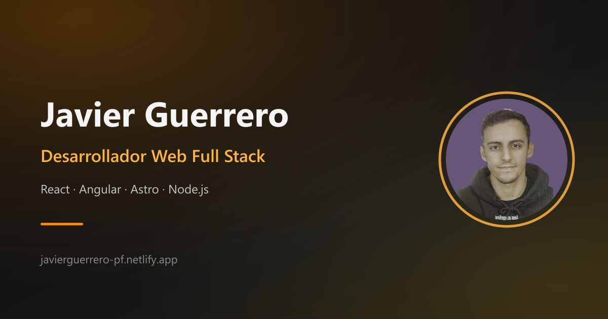

<div align="center">

# 💼 Javier Guerrero · Portfolio

Portafolio personal de **Javier Guerrero**, desarrollador Full Stack especializado en IA (servidores MCP y agent skills).
Sitio estático, bilingüe (ES / EN), con tema claro y oscuro, rápido, accesible y optimizado para SEO, construido con **Astro**.

[](https://javierguerrero-pf.netlify.app)
[](https://astro.build)
[](https://www.typescriptlang.org)

🔗 **[Ver el portafolio en vivo](https://javierguerrero-pf.netlify.app)**



</div>

---

## 📋 Tabla de contenidos

- [Sobre el proyecto](#-sobre-el-proyecto)
- [Características](#-características)
- [Diseño](#-diseño)
- [Tecnologías](#️-tecnologías)
- [Estructura del proyecto](#-estructura-del-proyecto)
- [Empezar](#-empezar)
- [Scripts disponibles](#-scripts-disponibles)
- [Internacionalización](#-internacionalización-i18n)
- [SEO](#-seo)
- [Despliegue](#-despliegue)
- [Contacto](#-contacto)

---

## 🧑‍💻 Sobre el proyecto

Este repositorio contiene el código de mi portafolio personal: una página única donde presento quién soy, mi experiencia profesional, los proyectos en los que he trabajado y cómo contactar conmigo.

El objetivo es tener un sitio **ligero, accesible y fácil de mantener**, que cargue prácticamente sin JavaScript en el cliente gracias a la arquitectura de islas de Astro, y que se pueda leer tanto en español como en inglés.

### Secciones

| Sección            | Descripción                                                          |
| :----------------- | :------------------------------------------------------------------- |
| **Sobre mí**       | Retrato, presentación, enlaces al currículum, LinkedIn y GitHub, e indicador de rendimiento en vivo. |
| **Experiencia**    | Línea temporal con mi trayectoria (puesto, empresa y fechas): Grupo CGI (IA y full stack) y Capgemini. |
| **Proyectos**      | Proyectos destacados con captura, descripción, tecnologías y enlace al código. |
| **Contacto**       | Datos de contacto y botones para enviar un correo o llamar. |
| **Pie**            | Enlaces directos a email, LinkedIn y GitHub. |

---

## ✨ Características

- 📊 **Indicador de rendimiento en vivo**: la portada muestra cuánto ha tardado la página en cargar y cuánto ha transferido en la visita real de cada usuario, medido con la Performance API del navegador. En las navegaciones con `ClientRouter` (como el cambio de idioma) solo mide lo descargado en esa navegación.
- 🌗 **Tema claro y oscuro**: en la primera visita sigue el tema del sistema (`prefers-color-scheme`) y se puede cambiar con un botón en la cabecera. La elección se guarda en `localStorage`, se aplica antes de pintar la página (sin parpadeo) y se mantiene al cambiar de idioma. También actualiza el `theme-color` del navegador.
- 🌍 **Bilingüe (ES / EN)** usando el sistema de i18n nativo de Astro, con enlace directo al otro idioma y su bandera.
- ⚡ **Rendimiento**: HTML estático generado en build, imágenes en formato `webp` y JavaScript mínimo (~84 KB transferidos en la primera visita).
- 🎞️ **Transiciones de página** con la View Transitions API (`<ClientRouter />` de Astro) y cabecera animada con `animation-timeline: scroll()`.
- 🔎 **SEO completo**: metaetiquetas Open Graph y Twitter, `canonical`, `hreflang`, datos estructurados JSON-LD (Schema.org), `sitemap.xml` y `robots.txt`.
- ♿ **Accesibilidad**: HTML semántico (`<ol>` para la experiencia, `<dl>` para el contacto), enlace "Saltar al contenido", foco visible, textos alternativos y respeto a `prefers-reduced-motion`.
- 📱 **Diseño responsive** sin scroll horizontal hasta 320 px de ancho.
- 🧩 **Iconos Tabler** como componentes `.astro` (SVG en línea con `currentColor`), que heredan el color del texto que acompañan.
- 🖼️ **Favicon propio** "JG" en SVG, con `favicon.ico` de respaldo y `apple-touch-icon.png` para iOS.
- 🚫 **Página 404 propia** en español e inglés, fuera del índice de buscadores (`noindex`).
- ✅ **Comprobación de tipos** con `astro check` antes de cada build.

---

## 🎨 Diseño

El diseño se basa en un pequeño sistema de tokens definido como variables CSS en `src/styles/global.css`:

| Token       | Claro     | Oscuro    | Uso                     |
| :---------- | :-------- | :-------- | :--------------------------------- |
| `--bg`      | `#e9ece9` | `#141a17` | Fondo (gris niebla)                |
| `--surface` | `#f4f6f4` | `#1b2420` | Superficies (indicador, capturas)  |
| `--ink`     | `#17201c` | `#e3e8e5` | Texto principal                    |
| `--muted`   | `#56615b` | `#9aa59f` | Texto secundario                   |
| `--accent`  | `#1e6a4c` | `#7fc4a3` | Verde bosque: enlaces, botones, foco |
| `--line`    | `#c9cfcb` | `#2e3a34` | Separadores y bordes               |

- **Tipografía**: una sola familia, *Schibsted Grotesk* (variable, autoalojada con Fontsource). Escala de 14 a 64 px y líneas de texto de unos 68 caracteres como máximo.
- **Maquetación**: una columna de 760 px alineada a la izquierda, con la misma retícula para todas las secciones (clase `.section`).
- **Botones**: solo dos variantes, `.button-primary` y `.button-secondary`.
- **Movimiento**: una única animación automática (el recuento de cifras del indicador de rendimiento), desactivada con `prefers-reduced-motion`.

---

## 🛠️ Tecnologías

| Tecnología | Uso en el proyecto |
| :--------- | :----------------- |
| [Astro 7](https://astro.build) | Framework principal, generación estática, routing, i18n y View Transitions. |
| CSS con variables | Sistema de diseño (tokens de color, tipografía y retícula) en `global.css` y estilos con ámbito en cada componente. |
| [TypeScript 5](https://www.typescriptlang.org) | Tipado de la lógica (i18n, constantes, props de componentes). |
| [@astrojs/sitemap](https://docs.astro.build/en/guides/integrations-guide/sitemap/) | Generación automática del sitemap con soporte multidioma. |
| [@astrojs/check](https://docs.astro.build/en/reference/cli-reference/#astro-check) | Diagnóstico y comprobación de tipos de los archivos `.astro`. |
| [Fontsource · Schibsted Grotesk](https://fontsource.org/fonts/schibsted-grotesk) | Tipografía variable autoalojada. |
| [Tabler Icons](https://tabler.io/icons) | Iconos de trazo en SVG. |
| [Netlify](https://www.netlify.com) | Hosting y despliegue continuo. |
| [pnpm](https://pnpm.io) | Gestor de paquetes. |

---

## 📁 Estructura del proyecto

```text
/
├── public/                  # Recursos estáticos servidos tal cual
│   ├── imgs/                # Retratos, capturas de proyectos e imágenes Open Graph
│   ├── favicon.svg          # Favicon "JG"
│   ├── favicon.ico          # Respaldo para navegadores antiguos (16, 32 y 48 px)
│   ├── apple-touch-icon.png # Icono para la pantalla de inicio de iOS (180 px)
│   └── robots.txt
├── src/
│   ├── components/          # Secciones y componentes de la página
│   │   ├── Header.astro           # Navegación fija con avatar que aparece al hacer scroll
│   │   ├── SobreMi.astro          # Portada e indicador de rendimiento
│   │   ├── Experiencia.astro      # Línea temporal de experiencia laboral
│   │   ├── Proyectos.astro        # Listado de proyectos
│   │   ├── Card.astro             # Proyecto destacado (captura, descripción, stack)
│   │   ├── Contacto.astro         # Datos de contacto
│   │   ├── Footer.astro           # Pie con enlaces de contacto y redes
│   │   ├── LanguageSelector.astro # Enlace al otro idioma con su bandera
│   │   ├── ThemeToggle.astro      # Botón para cambiar entre tema oscuro y claro
│   │   ├── StructuredData.astro   # JSON-LD para SEO
│   │   └── App.astro              # Composición de todas las secciones
│   ├── flags/               # Banderas del selector de idioma (SVG)
│   ├── icons/               # Iconos SVG como componentes Astro
│   ├── i18n/                # Traducciones y utilidades de idioma
│   │   ├── es.json
│   │   ├── en.json
│   │   └── index.ts
│   ├── layouts/
│   │   └── Layout.astro     # <head>, metaetiquetas SEO y estructura base
│   ├── pages/
│   │   ├── index.astro      # Versión en español  →  /
│   │   ├── en/index.astro   # Versión en inglés   →  /en/
│   │   └── 404.astro        # Página de error bilingüe
│   ├── styles/
│   │   └── global.css       # Tokens de diseño, tipografía, botones y estilos base
│   └── consts.ts            # URL del sitio, nombre, autor y redes sociales
├── astro.config.mjs
├── package.json
└── tsconfig.json
```

---

## 🚀 Empezar

### Requisitos previos

- [Node.js](https://nodejs.org) **>= 22.23.4**
- [pnpm](https://pnpm.io/installation) (recomendado; también funciona con npm)

### Instalación

```sh
# 1. Clona el repositorio
git clone https://github.com/javiergg13/MyPortfolio.git
cd MyPortfolio

# 2. Instala las dependencias
pnpm install

# 3. Arranca el servidor de desarrollo
pnpm dev
```

La web estará disponible en [`http://localhost:4321`](http://localhost:4321).

---

## 🧞 Scripts disponibles

| Comando            | Acción                                                         |
| :----------------- | :------------------------------------------------------------- |
| `pnpm install`     | Instala las dependencias.                                      |
| `pnpm dev`         | Inicia el servidor de desarrollo en `localhost:4321`.          |
| `pnpm start`       | Alias de `pnpm dev`.                                           |
| `pnpm build`       | Ejecuta `astro check` y genera el sitio de producción en `./dist/`. |
| `pnpm preview`     | Sirve localmente la build de producción para revisarla.        |
| `pnpm astro ...`   | Ejecuta comandos de la CLI de Astro (`astro add`, `astro check`…). |

---

## 🌍 Internacionalización (i18n)

El sitio usa el [routing i18n de Astro](https://docs.astro.build/en/guides/internationalization/):

- **Español** es el idioma por defecto y se sirve sin prefijo (`/`).
- **Inglés** se sirve bajo el prefijo `/en/`.

Todos los textos están en `src/i18n/es.json` y `src/i18n/en.json`. Para usarlos en un componente:

```astro
---
import { getI18N } from "../i18n/index";

const { currentLocale } = Astro;
const i18n = getI18N({ currentLocale });
---

<h2>{i18n.PROJECTS_TITLE}</h2>
```

Para añadir o modificar un texto, edita la misma clave en ambos archivos JSON.

Algunos textos son algo más que una cadena simple:

- **`ABOUT_ME_DESCRIPTION`** y los párrafos de la experiencia incluyen etiquetas `<strong>` y se pintan con `set:html`. Son textos propios del sitio, nunca contenido de usuarios.
- **`EXPERIENCE`** es una lista de puestos. Para añadir uno, añade un objeto al principio de la lista en los dos idiomas:

```json
{
  "date": "Marzo 2026 - Actualidad",
  "title": "Grupo CGI (Desarrollador especializado en IA)",
  "paragraphs": ["Diseño y desarrollo <strong>servidores MCP</strong>…"]
}
```

- **`PERF_TEXT`** y **`PERF_TEXT_CACHED`** son las frases del indicador de rendimiento. Usan los marcadores `{time}` y `{size}`.

---

## 🔎 SEO

El `Layout.astro` y el componente `StructuredData.astro` se encargan de:

- `title`, `description` y `canonical` por idioma.
- Enlaces `hreflang` (`es`, `en` y `x-default`).
- Metaetiquetas **Open Graph** y **Twitter Card** con imágenes específicas por idioma.
- Datos estructurados **JSON-LD** (`WebSite`, `Person` y `ProfilePage`).
- `sitemap-index.xml` generado automáticamente por `@astrojs/sitemap`.
- `robots.txt` apuntando al sitemap.

La URL base y los datos del autor se configuran en `src/consts.ts`.

---

## ☁️ Despliegue

El portafolio está desplegado en **Netlify**: [javierguerrero-pf.netlify.app](https://javierguerrero-pf.netlify.app).

Configuración de build:

| Ajuste              | Valor        |
| :------------------ | :----------- |
| Comando de build    | `pnpm build` |
| Directorio de salida | `dist`      |
| Versión de Node     | `22.23.4` o superior |

> Si cambias de dominio, actualiza `SITE_URL` en `src/consts.ts` y la línea `Sitemap` de `public/robots.txt`.

---

## 📬 Contacto

**Javier Guerrero Gallo**, desarrollador Full Stack especializado en IA

- 🌐 Portafolio: [javierguerrero-pf.netlify.app](https://javierguerrero-pf.netlify.app)
- 💼 LinkedIn: [javier-guerrero-gallo](https://www.linkedin.com/in/javier-guerrero-gallo-3989b9228/)
- 🐙 GitHub: [@javiergg13](https://github.com/javiergg13)

---

<div align="center">

Hecho con 💖 y [Astro](https://astro.build)

</div>
